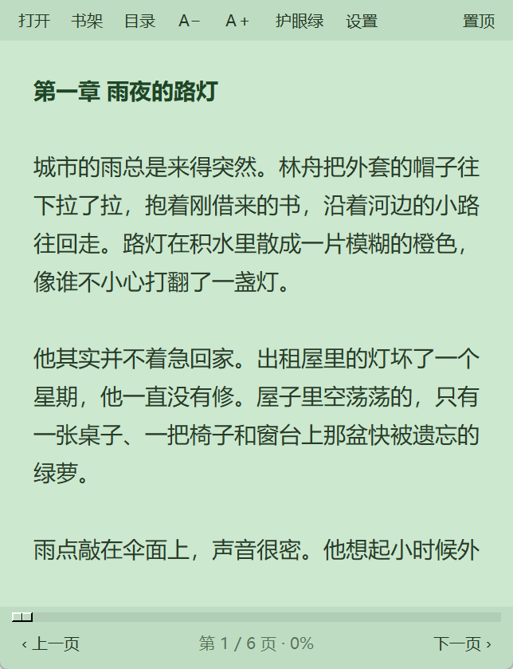

# TXT摸鱼神器

一个把 TXT 小说排版成桌面阅读窗口的小工具。原生窗口，不是网页；Win + Shift + S 随便一截，同事只会以为你在看文档。

跨平台：Windows / macOS。纯 Python + Tkinter，无第三方运行时依赖。



---

## 中文

### 功能

- **小窗口摸鱼**：默认窗口小巧、可随意缩放，窄到 300 多像素会自动收成紧凑工具栏
- **始终置顶**：一键把窗口钉在最前面，方便边工作边看
- **护眼配色**：8 套预设（护眼绿、暖纸黄、夜间、淡青、豆沙绿、雾灰、柔粉、星蓝）+ 自定义背景色 / 文字色
- **休息提醒**：默认每 30 分钟提醒远眺放松，间隔 10～120 分钟可调
- **书架**：打开过的书自动记入书架，随时续读；阅读进度按书保存
- **章节目录**：自动识别章节标题，可一键跳转；每章标题自动另起一页
- **排版可调**：字号、行距、字体实时调整，标点自动避头尾
- **多语言文本**：自动识别编码与章节格式，中日韩、英文、俄文等 TXT 都能正常打开
- **本地优先**：不联网、不上传，所有数据只存在本机

### 快速开始

需要 Python 3.8+（Windows 官方安装包自带 tkinter）。

```bash
python txt_moyu.py
```

打开后点击「打开」选择 TXT 文件即可。

仓库自带两个示例：

- `sample/示例小说.txt`（中文，三章）
- `sample/sample-en.txt`（English, two chapters）

> 从源码运行时会自动生成 `reader_state.json` 保存书架和进度，该文件已在 `.gitignore` 中排除，不会误上传。

### 快捷键

| 操作 | 快捷键 |
| --- | --- |
| 下一页 | `空格` / `→` / `↓` / `PageDown` / 滚轮向下 |
| 上一页 | `Shift+空格` / `←` / `↑` / `PageUp` / 滚轮向上 |
| 跳到开头 / 结尾 | `Home` / `End` |
| 打开文件 | `Ctrl+O`（macOS 为 `Command+O`） |
| 放大 / 缩小字号 | `Ctrl+ +` / `Ctrl+ -`（macOS 为 `Command+ +` / `Command+ -`） |

### 支持的语言与编码

编码识别顺序：BOM 优先（UTF-32 / UTF-8-SIG / UTF-16），其余候选逐个解码并打分择优：

`UTF-8`、`GB18030`（GBK/GB2312 超集）、`Big5`、`Shift-JIS`、`EUC-KR`、`CP1251`，失败时用 UTF-8 替换字符兜底，不会直接报错。

章节标题支持：

- 中文：`第一章`、`第1回`、`第三卷`、`序章`、`楔子`、`番外`、`尾声` 等
- 韩文：`제1장`、`제2화`、`제3절`
- 英文：`Chapter 1`、`Part II`、`Book Three`、`Prologue`、`Epilogue` 等
- 日文：`第一章` 等汉字写法，正文按原样显示

字体按系统自动回退：Windows 优先微软雅黑 / 宋体 / 楷体，macOS 优先苹方 / 宋体-简 / 黑体-简，Linux 回退 Noto Sans CJK / 文泉驿。英文按单词换行，中文按字断行。

### 数据文件位置

| 平台 | 路径 |
| --- | --- |
| Windows（源码运行） | 源码同目录 `reader_state.json` |
| Windows（打包后） | `TXT摸鱼神器.exe` 同目录 `reader_state.json` |
| macOS | `~/Library/Application Support/TXT摸鱼神器/reader_state.json` |

删除该文件即可清空书架与阅读进度。

### 打包

**Windows**

双击 `build_windows.bat`，或手动执行：

```bat
python -m pip install --upgrade pyinstaller
python -m PyInstaller --noconfirm --onefile --windowed --name "TXT摸鱼神器" txt_moyu.py
```

产物：`dist\TXT摸鱼神器.exe`

**macOS**

必须在 macOS 上执行（Windows 无法交叉编译出 .app）：

```bash
chmod +x build_mac.sh
./build_mac.sh
```

产物：`dist/TXT摸鱼神器.app`。若首次打开被 Gatekeeper 拦截，到「系统设置 → 隐私与安全性」点击「仍要打开」。

### 目录结构

```
txt-moyu/
├── txt_moyu.py            # 主程序（单文件）
├── build_windows.bat      # Windows 打包脚本
├── build_mac.sh           # macOS 打包脚本
├── sample/
│   ├── 示例小说.txt        # 中文示例
│   └── sample-en.txt      # 英文示例
├── docs/
│   └── screenshot.png     # 界面截图
└── .gitignore
```

示例文本为原创内容，仅用于演示自动排版与章节识别。

---

## English

A tiny desktop TXT novel reader. Native window, not a web page: a small always-on-top reading window that looks like work.

Cross-platform: Windows and macOS. Pure Python + Tkinter, no third-party runtime dependencies.

### Features

- **Small, stealthy window** — freely resizable; below ~400 px wide the toolbar collapses into a compact menu
- **Always on top** — pin the window above other apps
- **Eye-friendly themes** — 8 presets (eye-care green, warm paper, night, light cyan, bean green, mist gray, soft pink, star blue) plus custom background / text colors
- **Break reminder** — a gentle nudge to look away every 30 minutes by default (10–120 configurable)
- **Bookshelf** — every opened book is remembered, with per-book reading progress
- **Chapter navigation** — chapter headings are detected automatically, each heading starts a new page, and you can jump from a table of contents
- **Adjustable typography** — font size, line spacing and font family in real time, with CJK punctuation line-break rules
- **Multi-language text** — encoding and chapter patterns are auto-detected, so Chinese, Japanese, Korean, English and Russian TXT files just open
- **Local only** — no network, no upload; everything stays on your machine

### Quick start

Requires Python 3.8+ (the official Windows installer includes tkinter).

```bash
python txt_moyu.py
```

Click **打开 (Open)** and pick a TXT file. Two original samples are included:

- `sample/示例小说.txt` (Chinese, three chapters)
- `sample/sample-en.txt` (English, two chapters)

Running from source creates `reader_state.json` next to the script to store your shelf and progress. It is already listed in `.gitignore`.

### Keyboard shortcuts

| Action | Shortcut |
| --- | --- |
| Next page | `Space` / `→` / `↓` / `PageDown` / wheel down |
| Previous page | `Shift+Space` / `←` / `↑` / `PageUp` / wheel up |
| Jump to start / end | `Home` / `End` |
| Open file | `Ctrl+O` (`Command+O` on macOS) |
| Increase / decrease font | `Ctrl+ +` / `Ctrl+ -` (`Command+ +` / `Command+ -` on macOS) |

### Supported languages & encodings

BOM is checked first (UTF-32 / UTF-8-SIG / UTF-16), then candidate decoders are scored and the most readable result wins:

`UTF-8`, `GB18030` (superset of GBK/GB2312), `Big5`, `Shift-JIS`, `EUC-KR`, `CP1251`, with a UTF-8 replacement fallback instead of a hard error.

Chapter headings recognized: `第一章 / 第1回 / 第三卷`, `序章 / 楔子 / 番外 / 尾声`, Korean `제1장 / 제2화 / 제3절`, English `Chapter 1 / Part II / Book Three / Prologue / Epilogue`, and more.

Fonts fall back per platform: Microsoft YaHei / SimSun / KaiTi on Windows, PingFang SC / Songti SC / Heiti SC on macOS, Noto Sans CJK / WenQuanYi on Linux. English wraps by word, CJK wraps by character.

### Where your data lives

| Platform | Path |
| --- | --- |
| Windows (from source) | `reader_state.json` next to the script |
| Windows (packaged) | `reader_state.json` next to `TXT摸鱼神器.exe` |
| macOS | `~/Library/Application Support/TXT摸鱼神器/reader_state.json` |

Delete that file to reset the bookshelf and reading progress.

### Build

**Windows**

Run `build_windows.bat`, or manually:

```bat
python -m pip install --upgrade pyinstaller
python -m PyInstaller --noconfirm --onefile --windowed --name "TXT摸鱼神器" txt_moyu.py
```

Output: `dist\TXT摸鱼神器.exe`

**macOS**

Must be built on macOS (no cross-compiling from Windows):

```bash
chmod +x build_mac.sh
./build_mac.sh
```

Output: `dist/TXT摸鱼神器.app`. If Gatekeeper blocks the first launch, allow it under System Settings → Privacy & Security → "Open Anyway".

### Repository layout

```
txt-moyu/
├── txt_moyu.py            # single-file app
├── build_windows.bat      # Windows build script
├── build_mac.sh           # macOS build script
├── sample/
│   ├── 示例小说.txt        # Chinese sample
│   └── sample-en.txt      # English sample
├── docs/
│   └── screenshot.png     # screenshot
└── .gitignore
```

All sample text is original and only used to demonstrate layout and chapter detection.
